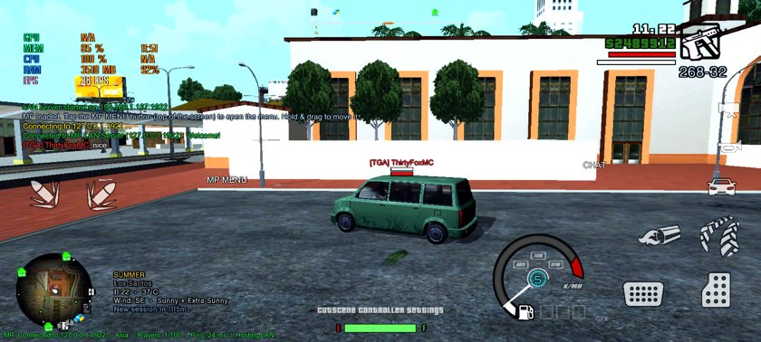
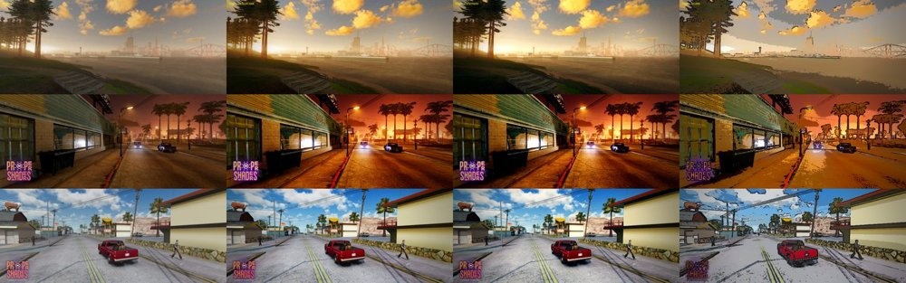

# ThirtyFoxMC

I build multiplayer, mods and tools for GTA San Andreas on Android.

[Join the MP Discord ↗](https://discord.gg/tbsDknk34y) · [MP website ↗](https://mpsamp-open.github.io/)

### [MP Multiplayer](https://github.com/ThirtyFoxMCx00E1/wagu)

Online multiplayer for GTA San Andreas on Android (AML mod). Public and private servers, Roleplay, Project Day Z, Brief Case War and MW3 gamemodes, Co-op story, a host map editor and 24/7 servers that run on a phone or a VPS.

---

### [Moquil](https://github.com/ThirtyFoxMCx00E1/wagu/tree/main/moquil)

The MP social app: accounts, communities with roles, channels, moderation, polls and events, chats, friends, a store with avatar decorations, and the game library.

---

### [MP login bot](https://github.com/ThirtyFoxMCx00E1/discordpy-bot)

The Discord side of MP accounts: /gen verification codes, /stats, /help tutorial and a 24/7 /streaming room. Runs on Railway.

---

### [HiveMQ regional brokers](https://github.com/ThirtyFoxMCx00E1/HiveMQ)

Self-hosted lobby servers for MP in Asia, Europe, NA and Oceania. Each runs HiveMQ Community Edition and the region's 24/7 default server; the game pings every region and picks the fastest.

---

### [Proper GFX Mobile](https://github.com/ThirtyFoxMCx00E1/ProperGFX)

Shaders, shadows and lighting effects for GTA San Andreas Android, hooked by exported symbol name for AML 1.4.0 and FLA 7.6.

---

### [PCMenu](https://github.com/ThirtyFoxMCx00E1/PCMenu)

The PC pause, title and options menu on GTA San Andreas Android, with an opaque or transparent (blurred game) backdrop.

---

### [V HUD](https://github.com/ThirtyFoxMCx00E1/VHUD)

Builds the V HUD mod for Android (32 and 64-bit) with the NDK in GitHub Actions and packages it with its assets and an install guide.

---

### [SPIKE](https://github.com/ThirtyFoxMCx00E1/SPIKE)

A free coding and knowledge agent for Android and Windows that runs on any OpenAI-compatible endpoint, local models included.

---

### [MP Termius](https://github.com/ThirtyFoxMCx00E1/Termius-SSH)

A phone-only web terminal and 24/7 status page for the MP HiveMQ servers.

---

<strong>Forks I build on</strong>

<a href="https://github.com/ThirtyFoxMCx00E1/AndroidModLoader"><strong>AndroidModLoader</strong></a> from RusJJ 

<a href="https://github.com/ThirtyFoxMCx00E1/ARMPatch"><strong>ARMPatch</strong></a> from RusJJ 

<a href="https://github.com/ThirtyFoxMCx00E1/AArchASMHelper"><strong>AArchASMHelper</strong></a> from RusJJ 

<a href="https://github.com/ThirtyFoxMCx00E1/AML_PrecompiledLibs"><strong>AML_PrecompiledLibs</strong></a> from RusJJ 

<a href="https://github.com/ThirtyFoxMCx00E1/CoopAndreas-DE"><strong>CoopAndreas-DE</strong></a> from Tornamic 

<a href="https://github.com/ThirtyFoxMCx00E1/open.mp"><strong>open.mp</strong></a> from openmultiplayer 

<a href="https://github.com/ThirtyFoxMCx00E1/reagent"><strong>reagent</strong></a> from Dryxio 

<a href="https://github.com/ThirtyFoxMCx00E1/gta-scout"><strong>gta-scout</strong></a> from Dryxio 

<a href="https://github.com/ThirtyFoxMCx00E1/gta-flow"><strong>gta-flow</strong></a> from Dryxio 

<a href="https://github.com/ThirtyFoxMCx00E1/ghidra"><strong>ghidra</strong></a> from NationalSecurityAgency 

<a href="https://github.com/ThirtyFoxMCx00E1/termux-app"><strong>termux-app</strong></a> from termux 

<a href="https://github.com/ThirtyFoxMCx00E1/hivemq-mqtt-client"><strong>hivemq-mqtt-client</strong></a> from hivemq 

<a href="https://github.com/ThirtyFoxMCx00E1/mysql-server"><strong>mysql-server</strong></a> from mysql 

 <a href="https://github.com/ThirtyFoxMCx00E1?tab=repositories">Explore all repositories ↗</a>

